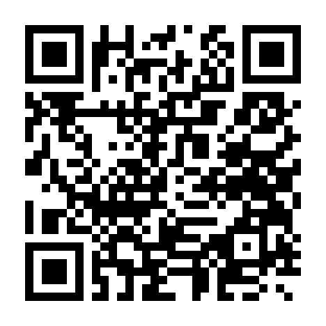

# 氣泡水平儀（手機網頁版）

**開啟網址：** https://kuresu0306dn0306-sudo.github.io/bubble-level/

用手機相機掃描 QR Code 開啟：

利用手機內建的方向感測器量測傾斜角度，單一檔案 `index.html`，不需安裝 App。

## 功能

| 功能 | 說明 |
|---|---|
| 平放模式 | 手機螢幕朝上平放，圓形氣泡顯示 X（左右）、Y（前後）傾角與總傾角 |
| 立起模式 | 手機側邊立起（直式或橫式），長條氣泡顯示與最近水平／垂直的偏差，並顯示絕對角 |
| 自動切換 | 依手機姿態自動切換兩種模式 |
| 歸零 | 將目前姿態設為 0°（補償手機殼凸起、鏡頭凸起或量測基準面），設定會保存在瀏覽器 |
| 取消歸零 | 清除歸零值，回到感測器原始讀數 |
| 鎖定讀數 | 凍結目前數值，方便在看不到螢幕的位置量測後再讀取 |
| 水平提示 | 偏差 ≤ 0.3° 時氣泡發光並短震動（Android） |

## 使用方式

感測器 API 只能在 **HTTPS** 下使用，建議用 GitHub Pages 開啟：

1. GitHub 儲存庫 → Settings → Pages
2. Source 選 `Deploy from a branch`，分支選放有 `index.html` 的分支、資料夾 `/ (root)`
3. 用手機瀏覽器開啟 `https://<帳號>.github.io/<儲存庫名稱>/`
4. 按「開始量測」；iPhone 會詢問「動作與方向」權限，請按允許
5. 可用瀏覽器的「加入主畫面」當成 App 使用

## 精度建議

- 手機感測器精度約 ±0.1～0.5°，適合一般檢查，精密量測仍建議用實體數位水平儀。
- 歸零的正確做法：先放在已知水平面按「歸零」；或在任意面量一次、手機原地旋轉 180° 再量一次，取兩次平均即可消除手機本身誤差。
- 參數（濾波強度、水平容許值、滿刻度角度）在 `index.html` 的「設定」區段可調整。

## 加到手機桌面

- **iPhone（Safari）**：開啟網址 → 下方「分享」按鈕 → 「加入主畫面」→ 新增
- **Android（Chrome）**：開啟網址 → 右上角「⋮」→ 「加到主畫面」或「安裝應用程式」→ 安裝

## 離線使用

第一次連網開啟後，程式會自動存到手機裡，之後沒有網路也能開啟。
有網路時會自動更新到最新版（訊號差超過 3 秒就直接用手機裡的版本）。
修改檔案後，請把 `sw.js` 裡的 `CACHE` 版本號 +1。
